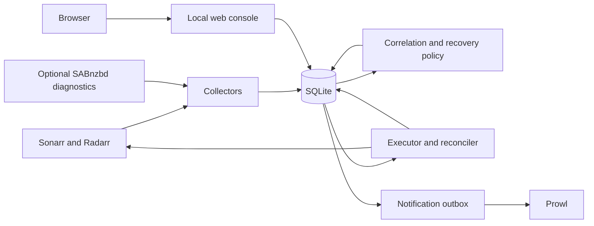

# Rescuarr product and system design

**Status** Draft for implementation planning, 14 November 2026. The existing repository contains a Python connectivity prototype. This design proposes the production architecture.

Rescuarr should make a normal Sonarr and Radarr installation require less attention. It detects stuck imports and confirmed failed downloads, checks whether the existing download can satisfy the original request, and recovers it or asks the owning application for a replacement. It shows the operator the small number of problems that genuinely need a person, including failures shared by many downloads.

| Design document | What it specifies |
| --- | --- |
| This document | Product requirements, architecture, persistence, operational limits, security, deployment |
| [Recovery and learning](RECOVERY_DESIGN.md) | Diagnosis, evidence requirements, action policy, reconciliation, deterministic learning |
| [Service integrations](INTEGRATIONS_DESIGN.md) | API capabilities, adapter contracts, version checks, Prowl and downloader boundaries |
| [Web interface](UI_DESIGN.md) | Screens, workflows, interactions, accessibility and UI behavior |
| [Build and verification plan](ROADMAP.md) | Delivery sequence, release gates and acceptance scenarios |

## 1. Product requirements

### Who and what it serves

The primary operator runs at least one Sonarr or Radarr instance and wants the queue to resolve itself. They have already set monitoring, quality profiles, custom formats, language requirements, minimum scores, and upgrade preferences in those applications. Some installations have separate HD and UHD instances, use different root folders, or share a download client. Rescuarr must also be useful with one Arr instance and zero direct downloader integrations.

Rescuarr's unit of work is a blocked job and its relationship to one or more expected library targets. A Sonarr season pack can represent multiple episodes and several queue rows. A Radarr entry represents a movie in a particular instance. The same title in HD and UHD can represent two legitimate targets. The interface should present one incident when a NAS or client failure accounts for many blocked jobs, and show which individual jobs need attention after the incident clears.

### Requirements and limits

| ID | Requirement | Operator-visible result |
| --- | --- | --- |
| P01 | Recognize failed downloads, failed or stalled imports, and infrastructure faults from upstream observations. | Each case states what failed, the available evidence, the owning service and the next check. |
| P02 | Salvage an eligible existing download first. Verify exact target identity and profile suitability, then let the owner import and verify the result. | A completed episode can recover without another grab. A lower-quality or wrong-episode candidate remains available for review. |
| P03 | Reject a confirmed unusable release and ask Arr for an eligible replacement when allowed. | The original release's disposition, any actual blocklist entry, the replacement grab and eventual import are visible separately. |
| P04 | Reuse outcomes through deterministic, inspectable rules. | A learned match lists its evidence, scope, successes and reversals. The operator can disable it or reset its history. |
| P05 | Treat shared failures as incidents. | A disconnected volume affecting dozens of jobs produces a common diagnosis and prevents destructive treatment while affected evidence is stale or unsafe. |
| P06 | Give Arr final authority over the user's intended media. | Monitoring, quality profile, upgrade policy, format rules and any existing satisfactory file govern action. Rescuarr offers visibility into those choices. |
| P07 | Keep the routine setup small. | Add Arr URL and key, verify the instance, observe the queue, optionally add a Prowl key and turn on individual recovery actions. |
| P08 | Run lean on small servers and normal desktops. | One process and one local database, browser UI included, with measurable CPU, memory and I/O budgets. |
| P09 | Run in Linux containers and natively on Windows, macOS and Linux. | Same data model, action guarantees and UI across platforms. Packaging and service integration differ by OS. |
| P10 | Keep a useful action and diagnostic history by default. | Every attempted upstream write and its outcome appears in the audit trail. Routine logs are bounded and exportable. |
| P11 | Notify through Prowl. | Actionable incidents, attention needed, recoveries and summaries can be routed and grouped. Local records survive notification failures. |
| P12 | Make the web console comprehensive. | Cases, incidents, upstream health, capacity, jobs, history, patterns, control settings, diagnostics and backups are accessible from the same UI. |

The intended coverage includes Arr-owned Usenet and torrent queues. Torrent seeding and data lifetime remain under the Arr and downloader policies. Automatic physical removal is reserved for positively identified, single-owner Usenet jobs that pass the stricter recovery contract. The first release has one optional direct downloader adapter, SABnzbd, for read-only evidence. Arr-managed clients remain visible through Arr when no direct adapter exists.

Rescuarr has no media-folder mount requirement. Queue management, path interpretation, moves, imports and blocklisting go through the owning Arr instance. The application does not need indexer credentials or access to release payloads. Upstream repair belongs to the relevant service operator. The dashboard can diagnose path mappings and capacity, identify the affected root, explain the next step, and detect whether the change took effect. Features such as renaming media on disk, changing permissions, archive extraction and library-wide upgrade searches stay outside the recovery engine.

### The operator experience

1. Add Sonarr and Radarr, including any alternate-quality instances. The first sync inventories queues, storage, health and relevant configuration. It shows unavailable capabilities and creates cases for existing problems without taking action.
2. Review a case with a concrete recovery proposal, the expected targets and the evidence from the originating grab. Enable automation per action once its effect is understood, or approve one eligible action from that case.
3. Return to a dashboard that leads with what requires attention. Useful outcomes include `Recovered from existing download`, `Replacement imported`, `Already satisfied`, and `Held for storage incident`. An accepted command or vanished row never earns a recovery count.
4. Drill from an incident into affected roots, clients and cases. View recent failed paths or correlated log excerpts after redaction, then recheck the dependency once it is fixed.
5. See what Rescuarr learned from earlier outcomes, where that evidence applies, and whether enabling a specific automation would have changed previous cases. Replay is local and read-only.

## 2. Production architecture

### Runtime and dependencies

Use one Go binary with standard HTTP, HTML templates and embedded assets, plus a maintained cgo-free SQLite driver. Pin the compiler, dependencies and the SQLite runtime, verify supported builds on the release matrix and keep an inventory of shipped components. Start with Go's `net/http`, `html/template`, `embed`, `database/sql`, structured logging and a small set of vetted security dependencies. Benchmark the driver and file-system durability across the target OSs before committing to a release build. A driver choice that cannot build or meet release tests on a target is grounds to change the driver. [Go embedding](https://pkg.go.dev/embed) · [Go HTTP](https://pkg.go.dev/net/http) · [Candidate SQLite driver](https://pkg.go.dev/modernc.org/sqlite)

One binary serves browser requests and runs background workers. SQLite holds both the application's business state and durable work. The first release has a single active process per data directory. It requires no Redis, message broker, external database or frontend build service at runtime. Package boundaries define ownership and allow independent testing inside the binary.

| Module | Responsibilities | May write upstream |
| --- | --- | --- |
| Configuration and capabilities | Local instance UUIDs, identity epochs, connectivity, policy and adapter manifest | No |
| Scheduler and collectors | Timers, pagination, normalization, liveness, fingerprints, read budgets | No |
| Correlator | Job and target identity, ownership evidence, queue history, incident links | No |
| Diagnosis and policy | Pure evaluation from a case revision, capabilities, policy and learning snapshot | No |
| Action executor and reconciler | Persist intent, fresh guards, dispatch, observe and record outcome | Only the documented Arr operations |
| Learning | Verified sample eligibility, counters, scope invalidation, pattern promotion and replay | No |
| Notification outbox | Deduplicate, schedule and send Prowl notifications | Prowl delivery only |
| Web console | Render read models, authenticate, accept local commands, show eligibility and outcomes | No |
| Storage and maintenance | Transactions, migrations, retention, backup and restore | No |

### Processing from observation to outcome

1. A collector obtains a bounded set of observations. Each observation records source, capability revision, upstream and local time where available, paging coverage, status and a normalized evidence hash. Parse and normalize outside write transactions.
2. Persist each coherent snapshot and mark an observation watermark. Incomplete queue pages can update positive observations. They cannot establish that an entry disappeared or trigger an action that requires full job or ownership coverage.
3. Incrementally derive cases and incidents from changed fingerprints. Before a policy decision, load the smallest set of required details such as matching grab history, candidate files, monitored targets, profile or root status. The same case revision is reused for dry-run display, approval and executor preflight until its material inputs change.
4. Store a recommendation or durable intent, including exact upstream identity, intended effect, expected readbacks, policy and capability versions, expiry, and the reason. Changes to approval, credentials, account identity, policy or evidence invalidate undispatched intent when relevant.
5. The executor takes a durable lease and checks for shared-client conflicts, applicable incidents, current ownership and fresh upstream evidence. It records that a request may be sent before opening the connection. Upstream calls run outside database transactions. Reconciliation uses bounded readback when the response fails or the result is still pending.
6. Write verified outcomes, audit events and notification outbox entries in a single transaction where they share an event. Update learning only from eligible terminal outcomes. Startup replays local pending work from SQLite after validating instance identity and configuration.

The authoritative answers live at different layers. Arr owns monitored targets, preferences, commands and library state. The configured downloader can corroborate its own job and staging facts. Rescuarr owns the decision history, pending intents, policies and rule outcomes. A remote cache can age into `stale` or `unknown`. It cannot become a new authoritative answer because a request failed.

### Concurrency and failure boundaries

- Hold an exclusive OS lock for the resolved local data directory for the life of the process. Store the instance ID in SQLite. Advisory locks and database paths on network shares or cloud-sync folders are outside the supported storage layout.
- Coalesce concurrent reads of the same endpoint and schedule one non-overlapping queue scan per instance. Carry deadlines and cancellation through UI requests and collectors. Avoid starving post-write verification behind background discovery.
- Allow one in-flight mutating Arr action per instance. Also serialize conflict keys for a shared physical download job and for overlapping target sets. Derive these keys from verified scope. When the same job may be visible to multiple owners, require disambiguation before a write with job-wide effects. Cross-instance independence applies only when these keys are disjoint.
- SQLite uniqueness plus a persisted operation ledger enforce one live intent per effect fingerprint. Leases prevent double execution within Rescuarr. Arr, the download client and another operator may act concurrently. No transaction spans both systems, and the upstream API generally has no Rescuarr idempotency token.
- If a process dies after recording dispatch and before recording the response, restart marks the attempt uncertain and performs readback. An expired dispatch lease permits reconciliation. It never permits automatic resending. Verified absence of effect is distinct from a missed response. A new intent requires the full recovery policy to be satisfied again.
- On local storage write failure or audit unavailability, stop dispatch and expose a degraded status. On Arr timeouts, unsupported schemas or missing credentials, suspend affected actions and preserve cases for later reconciliation. Never infer absence from a failed collection.
- A global pause, instance pause and action-specific pause are durable. They stop newly dispatched operations once committed and leave readback running for earlier requests. A command already accepted by an upstream service can complete after the pause. Record the exact pause scope and time in the audit stream.
- On clean shutdown stop scheduling, drain bounded local writes, allow active HTTP calls a short grace period, and leave remaining operations in durable reconciliation state. System resume, NTP adjustments and time-zone changes trigger a bounded fresh sync. Timers use monotonic durations while stored timestamps use UTC. Large clock discontinuities invalidate time-sensitive approvals.

## 3. Data model and retention

### Persistent records

Identifiers below are logical. The recovery and integration specs determine the exact fingerprint and evidence fields.

| Entity | Key and core fields | Lifecycle and constraints |
| --- | --- | --- |
| Instance | Local UUID, type, normalized base URL, display name, identity epoch, observed version, expected identity, credential reference | IDs from upstream are scoped by UUID and epoch. Replaced or restored upstream databases require explicit rebind if identity is uncertain. |
| Capability snapshot | Instance, adapter revision, detected version, per-operation availability and rationale | Store observation time and upgrade diff. A major upgrade, unsupported field or changed identity can suspend affected writes. |
| Poll state | Instance, endpoint class, cursor/watermark, complete/partial status, freshness, backoff | Move a cursor only after durable processing. Tail overlap and dedupe handle repeated or out-of-order history. |
| Job | Local UUID, owner instance and epoch, download-client reference, original download ID where available, queue aliases, release identity, protocol, status | Preserve aliases separately. Unknown IDs use observation-local correlation and cannot unlock a write. Never dedupe across instances by title or hash alone. |
| Target | Instance and epoch, entity type and ID, episode or movie file association, root, monitored state, profile revision | Unique within the owning instance. Store current versioned profile and file evidence as small facts. |
| Case and case revision | Local UUID, generation, job/target joins, primary diagnosis, evidence refs, next recheck, disposition | Stable across polls. Create a new revision when a material guard changes. Reopen or create a successor when the originating job changes. |
| Observation and evidence | Scoped subject, source, type, event time, observed time, expiry, normalized fields and content hash | Positive observation and verified absence have different types. Keep payloads bounded and redact at collection. |
| Incident | Type and scope (instance, root, client, staging volume or local store), evidence, affected case joins, health epoch | Persist hold state and reopening history. Require fresh qualifying evidence for automatic clearing. |
| Policy and policy revision | Global defaults, instance overrides, action settings, exclusions, budget and activation metadata | Immutable revision plus effective view. Precedence resolves per field and shows its source in UI. Hard guardrails remain mandatory. |
| Action intent and attempt | Case/revision, effect fingerprint, action, target set, upstream keys, preflight hash, actor, dispatch state, command reference | Unique active effect and serialized conflict scopes. Each retry or uncertainty resolution has its own audit record. |
| Outcome | Attempt, verification category, final evidence, time, effect attribution, target-level result | Required for success counters. Mixed/unknown outcomes are first-class. |
| Pattern and sample | Versioned typed fingerprint, scope/epoch, counted eligible outcomes, counterexamples, rule state, explanation | Link evidence IDs. Learning state changes have immutable audit events. Eligible observations deduplicate by independent job and target scope. |
| Audit event | Sequence, UTC time, actor, kind, correlation IDs, decision and sanitized delta | Append-only through supported application interfaces. An administrator with database access can change it. |
| Notification outbox | Event/routing key, destination version, sanitized payload, scheduling, attempts and status | One row per event and route. Delivery can be ambiguous independently of recovery. |
| Session and credential references | Hashed session or setup identifiers, expiry and local secret reference | Never embed service keys in exported case data. Session revocation and secret rotation are explicit. |

Use foreign keys and compound indexes on active case state and next action time, instance and upstream identifiers, scope plus updated time, and audit sequence. Cursor pagination is stable across refreshes. Keep recent detailed evidence by normalized type. Put large strings behind small redacted excerpt fields. Inactive reports and charts use materialized day-level counters updated in the write transaction or via a bounded maintenance job. Full-queue JSON and upstream log bodies are temporary parse inputs.

### SQLite behavior

Keep the database on local disk. Use WAL for concurrent reads, bounded reader connections, one serialized writer, a measured busy timeout and short transactions. Use durable synchronization for the dispatch ledger, including across sudden power loss. A writer's transaction persists all related records before any upstream effect. Limit dashboard and export transactions so checkpoint progress remains possible. Monitor WAL size, read transaction duration and disk health. Verify the chosen SQLite library includes the upstream WAL reset bug fix before shipping. [SQLite WAL](https://sqlite.org/wal.html)

| Data | Proposed default |
| --- | --- |
| Temporary upstream response bodies | Discard after parse. Opt-in diagnostic captures use independent redaction, expiry and size limits. |
| Poll detail and diagnostic excerpts | 14 days for routine detail, with a volume cap. Keep summaries for evidence attached to active cases and recent outcomes. |
| Operational logs | Local structured logs with size and age limits. Default total local rotation budget 50 MiB, with stdout in containers. |
| Closed case timeline, outbox and audit | 180 days by default. Never prune unresolved attempt or active incident evidence. Preserve compact retry/learning records for any still-open decision windows. |
| Day-level totals | 13 months by default. Document the exact denominator for recovery rate, and use observed bytes only when quantifiable. |
| Backups | Daily rolling local snapshots with configurable destination, proposed 7 daily and 4 weekly. Surface last successful backup and storage pressure. |

Run cleanup in bounded batches. If retention reduces the evidence behind a pattern below its required sample set, suspend it or keep redacted sufficient evidence within the configured retention. User resets retire rules and samples with an audit event and keep pending action guards intact. Pin records needed for in-flight reconciliation. Configure minimum free space for local writes and reserve capacity for a checkpoint and durable rollback. A full database or store switches the app to degraded read mode and suppresses writes to Arr.

Use SQLite's online backup mechanism or a tested equivalent supported by the chosen driver. Verify backup by opening the copy, running integrity checks, checking schema version and counting unresolved effects. Publish backup files atomically. Backups include sensitive case history and should inherit restrictive permissions. The portable bundle omits separately stored service credentials by default. Document an opt-in encrypted offline secrets export with password entry, distinct from standard backups. [SQLite online backup](https://sqlite.org/backup.html)

Restore runs with the service stopped or in maintenance mode under the exclusive lock. Verify before replacing any live data, and keep a pre-restore snapshot. Any restored dispatch ledger may predate an upstream effect, so start in Observe and reconcile the overlap against live history before allowing dispatch. Migrations use checksummed ordered revisions and a pre-upgrade backup. Failed migrations leave dispatch disabled. Older binaries reject schemas they cannot read, and rollback uses the matching backup plus the same Observe/reconcile procedure.

## 4. Scheduling, capacity and efficiency

### Read budget and freshness

Use jittered polling for correctness across restarts and missed events. Optional authenticated event hints can move one instance's poll earlier and dedupe bursts. They carry no authorization to change media. Health, log, history and candidate inspection have separate budgets. Reserve capacity for preflight and post-write reads.

| Work | Proposed starting budget |
| --- | --- |
| Active queue | Every 45 seconds per instance with jitter. Increase to 120 seconds once idle. Scheduled scope has a short deadline. |
| Action verification | Per operation, start within 5 seconds, then bounded backoff up to normal poll interval. Long-running imports and replacement monitoring use state-specific deadlines from recovery design. |
| Health and storage | Every 5 minutes normally, immediate bounded refresh for an applicable incident or upcoming dispatch. |
| System and configuration capability | On startup, after explicit reconfiguration, periodically, and on unexpected schema/status signals. Cache profiles and stable resources for 15 minutes, with material fields refreshed on action. |
| History, logs and candidates | Fetch for changed cases, incident detection, and reconciliation. Use bounded history overlap and log-tail reads. Avoid scanning every candidate on every poll. |
| Transport | Default shared ceiling 8 upstream reads in flight, 2 per instance. Bound each request and poll cycle independently. Respect backoff, rate-limit headers and local load. |

Use capped exponential backoff for timeout, outage and rate-limit reads, with stale timestamps kept visible. A client returning too much data triggers an explicit partial state. Start with 100 rows per page where supported, cap queue work at 2,000 rows per scheduled pass, and reserve work for already-active or changed cases. Continue any long scan incrementally where consistent paging permits. When concurrent paging changes prevent proof of completeness, require fresh job-scoped evidence for writes or hold. Cache by owner scope and evidence fingerprint. The web UI reads local projections, so opening multiple browser tabs does not increase polling of Arr. All timing and cap values are release targets to tune through the performance gates.

### Ecosystem and storage model

Model four relevant capacities independently: local Rescuarr data, source download staging, destination library, and any observed intermediate working space required by the importer or downloader. A source gets a capacity record only when it can be mapped to a reported volume or an explicitly associated, read-only probe. A configured root and a volume are distinct. Known physical volume aliases prevent summing the same bytes twice across roots or instances. When equivalence is uncertain, show separate observations and mark totals incomplete.

Each observation includes scope, source, available and total bytes where provided, time, confidence in the root-to-volume match, and staleness. Arr's system disk data reports what its process sees. A Windows path, a NAS mount, a remote-path mapping and the container's own filesystem can all refer to different storage. Prefer data reported by the system that will perform the action. Optional future probes can query administrator-mapped roots without walking media, expanding arbitrary paths or fetching arbitrary URLs.

| Condition | Handling |
| --- | --- |
| Destination import is copy-based or allocation behavior is unknown | Assume full candidate file bytes plus configured safety margin. Subtract reservations for overlapping accepted jobs once. Unknown candidate size or relevant capacity gates autonomous import. |
| A compatible hardlink or atomic move is independently proven | Use the lower allocation estimate supported by the capability. Keep a reserve for metadata and a conservative fallback when the transport changes. |
| Replacement uses a different staging area or size is unknown | Use known client/category mapping and an operator-configured conservative reservation for the relevant class. If a safe upper bound cannot be established, hold the automated search. |
| Storage API is stale, incomplete or mapping is uncertain | Show the missing scope and request fresh evidence. Keep read-only diagnosis active. Missing bytes are unknown. |
| Shared volume is missing, read-only or below floor | Open an incident and prevent affected actions. Require consecutive clean observations and re-evaluation of individual cases before resuming. |

Start with a configurable reserve of 10 GiB per media volume, a separately sized reserve for the local database, and visible per-volume overrides for smaller installations. Use confirmed candidate or declared job size where available. Treat aggregate `avoided redownload` bytes as measured only when the original job size is known and recovery actually avoided a replacement. Label space savings as estimates when allocation or hardlinks cannot be measured. Preserve separate counts for pending, held, verified and unknown cases.

### Performance targets

Benchmark release builds against reproducible simulated Sonarr, Radarr and SABnzbd endpoints. Baseline hardware is two ARM64 CPU cores, 2 GiB RAM and local SSD-class storage. Test a native desktop build as well.

| Scenario | Release target |
| --- | --- |
| Idle, two Arr instances with empty queues | Mean CPU under 1% of one core over 30 minutes and steady RSS under 80 MiB after warm-up. |
| Normal, four instances and 500 queue entries total | RSS under 150 MiB, p95 local dashboard response under 300 ms, no upstream request when changing local filters. |
| Burst, 2,000 queue entries with a shared failing root | Diagnose the common incident within two successful bounded scans, cap history fan-out, cap notifications to one grouped incident plus updates, and apply no destructive actions for that scope. |
| Long running, 100,000 historical case or audit rows | p95 case list and recent audit paging under 300 ms. Show database and WAL size. Confirm periodic pruning and backups do not stall dispatch or readback. |
| WAN or repeated upstream failure | Bounded worker count, memory and log growth. Render stale data with elapsed time. Retain operator control and durable reconciliation. |

Measure binary/image size, poll requests per minute, memory, CPU, write amplification and response latency in the release report. Proposed size targets are a native binary under 45 MiB and compressed Linux image under 60 MiB. Tune regressions through indexes, smaller read models, bounded batches and fewer upstream calls before reducing diagnostic coverage.

## 5. Security, privacy and operator control

- On first run bind locally and generate a single-use setup token with a short expiry. Print it only to the local setup channel or write it to a private file in the data directory for headless use. Persist only its hash. Create one local owner account. The web interface requires authentication after initialization even on loopback.
- Store passwords with a current vetted memory-hard password hash, random salts and parameters benchmarked for the target host. Use random hashed session IDs, HttpOnly and SameSite cookies, Secure cookies over TLS, rotation on login, idle and absolute expiry, and server-side logout. Enforce CSRF validation and origin checks for state changes, including setup and reconfiguration. Expose CLI owner recovery through local data-directory access, audit it and revoke existing sessions.
- Use localhost by default for native and Docker host publishing. Docker may listen on the container network, with host publishing limited to loopback. LAN access uses explicit configuration, an authenticated UI and TLS at a trusted reverse proxy. Accept forwarded headers from configured proxy addresses only. Validate hosts and configured base path to prevent links or redirects being manufactured from requests.
- Treat Arr and downloader keys as administrative secrets. Accept file-based secrets in containers and owner-protected local files on native installs. Resolve references at use time and use `0600` files and private directories on Unix, and owner ACLs on Windows. Exclude secrets from UI reads, metrics, traces, logs, diagnostic export and default backups. Reject mixed-origin redirects, URLs with userinfo, embedded credentials or unsupported schemes. URL changes require owner action and invalidate pending writes for the old identity.
- Local private URLs are ordinary supported destinations because Arr is self-hosted. Scope outbound access to configured instance endpoints and the official Prowl endpoint. Validate redirects, timeouts, response limits and TLS. Links and names supplied by upstream services are untrusted text. Render escaped HTML and permit deep links only through configured bases and known routes. Use a restrictive Content Security Policy, same-origin forms and assets, and explicit secret masking. Never fetch links embedded in releases or log text.
- Keep Prowl payloads private by default. Send generic incident type, status and count, and include titles or a configured private link only when enabled. Preserve per-route preferences and outbox history. Treat an acknowledgement as provider acceptance.
- Record actor and scope for approvals, pauses, policy changes, rule resets, credential rotations, new URLs, restores and exports. Deliberately visible controls include exclusions by owner instance, root and target, and an action-specific kill switch.
- Support a sanitized diagnostic bundle with app/build version, capability summary, counts, timing, bounded log excerpts and pseudonymous correlation IDs. Show a preview before download. Exclude full paths, raw queue/history and keys by default. No off-device telemetry is required.

### Application interface

The UI reads local paginated projections. Use server-rendered forms for edits and approvals, with tiny same-origin JavaScript for partial refresh. Implement route contracts and empty/stale/error states in the [web interface design](UI_DESIGN.md). There is one owner role for the first release. A supported external write API and delegated roles require a separate authorization and versioning design. A minimal health endpoint reports local process liveness and readiness without exposing case data, instance names or secrets. Detailed dependency status requires a session. Distinguish local readiness, service degradation, and recovery pause. Upstream outages can be shown while the UI remains ready.

State-changing actions use local POST requests, a CSRF token, a request idempotency key and the expected revision. Return a stale-state conflict when the material inputs have changed. A successful local submit exposes intent ID and status. A rejected preflight shows the guard that failed and the timestamp of the freshest evidence. Same-origin polling or conditional requests use a revision cursor, fetch only visible deltas, and stop or slow in background tabs. Upstream credentials are never sent to the browser.

### Configuration ownership

Bootstrap settings include the listen address, data path, proxy trust, log sink, and references to externally managed secret files. Resolve these at startup and expose their effective sources. The SQLite configuration owns instances, notification routes and operational policy. Apply setting edits atomically with a new revision and a single audit event. Validate derived scopes, limits, and required capabilities against the proposed full configuration before applying it. Concurrent edits to the same revision return a conflict. Maintain explicit defaults and migrate existing stored values independently of changes to defaults for new installations.

| Change | Runtime effect |
| --- | --- |
| Display name, time zone or view preference | Refresh local presentation. Preserve resource identity. |
| Policy, exclusion or capacity floor | Re-evaluate affected undispatched intents and approvals. Keep existing attempt and retry ledgers. |
| URL, service identity or credential reference | Test the proposed destination with bounded read-only checks. On activation, refresh or rebind identity and capabilities before dispatch, preserve old scope for reconciliation and prevent pending writes from crossing it. |
| Prowl credential or routing change | Validate or preview the new route. Keep the old delivery history and cancel queued notifications that no longer match the active route. |
| Retention | Apply incrementally and protect records required for pending work or active rule eligibility. |

### Logging and diagnostics

Enable structured operational logs at INFO by default. Use stable event names, timestamp, level, component, opaque correlation ID, duration and sanitized result. Emit state transitions and noteworthy aggregate poll results. Ordinary successful endpoint requests belong to sampled debug logging, with repetitive errors coalesced by instance and reason. Emit the first error promptly, then count suppressed repeats and record the recovery event. Distinguish operational logs from durable action audit events. An operator changing log verbosity cannot suppress the latter.

Support bounded, time-limited debug sessions. Apply the same secret redaction before serialization, including nested error fields, URL query strings, and upstream HTML responses. Keep error records actionable with a known endpoint family, status code and correlation ID. Show upstream log excerpts only when a relevant case or incident needs them, and expose which time range and severity were observed. Container stdout needs a configured host rotation cap. Native file rotation uses a size-and-age budget, plus a bounded in-memory fallback for startup errors if local logging fails. A failure to persist the audit record prevents dispatch even when operational logs still work.

## 6. Native and container distribution

| Target | Proposed packaging | Data and service defaults |
| --- | --- | --- |
| Linux amd64 and arm64 | Compressed native binary and optional systemd unit | User mode follows XDG state/config paths, with an explicit data directory for service use. Run under an unprivileged account. |
| macOS Apple silicon and Intel | Signed and notarized archive and optional per-user launch agent | Data under the user's Application Support directory by default. Provide native start/stop and browser URL in docs. |
| Windows x64 and ARM64 | Signed portable archive with optional service registration after qualification | Default interactive storage under LocalAppData. Use an explicit ACL-protected service data directory for unattended operation. |
| Linux containers amd64 and arm64 | Versioned, digest-pinnable OCI image and Compose example | Non-root user, persistent local `/data`, file secrets, read-only root filesystem where supported, loopback host publishing, no Docker socket or library mounts. |

Test every shipped architecture natively or in a representative VM for startup, migrations, suspend or restart and an upgrade and restore. A cross-compiled binary alone is insufficient. A writable local data directory is the only required filesystem permission. Validate NAS deployments where the binary/container runs on the NAS with a local volume for SQLite and talks to Arr over HTTP. Media may live on network shares mounted by Arr. Windows UNC and drive-letter paths and Unix paths are interpreted within the reporting service's namespace.

Provide minimal commands for serving, version/doctor, backup, restore and owner recovery. Package checksums, SBOM and signing metadata with each release. Use explicit upgrades that preserve settings, audit and enabled actions. Changed capabilities gate writes independently. Keep startup failure messages actionable, with file permission, data-directory ownership, lock and schema errors distinguished.

## 7. Operational signals and release decisions

| Signal | Use |
| --- | --- |
| Observation freshness and coverage by source | Distinguish missing or paginated data from an empty queue. |
| Poll rate, payload bytes, status family, latency | Identify upstream pressure, timeouts or schema drift. |
| Cases by state, top diagnoses, affected scope | Make shared incidents visible and count operator effort by cause. |
| Planned, attempted, verified, partial and uncertain effects | Measure the pipeline without crediting accepted commands as recovered media. |
| Retry budgets and cooldowns | Make exhausted or delayed actions explainable. |
| App data and media capacity | Locate the relevant full volume without assuming its path or physical equivalence. |
| Notification backlog and last provider acknowledgement | Identify delivery problems independently of recovery. |
| Rule state, sample eligibility, last reset and reversals | Let operators inspect why a decision changed. |
| SQLite busy time, WAL growth, disk pressure and backup age | Detect local degradation before it threatens the dispatch ledger. |

The work is planned in [the release and verification roadmap](ROADMAP.md). It treats exact API behavior and cross-platform runtime budgets as release evidence.

### Features that improve unattended recovery

| Feature | Useful behavior | Evidence and boundaries |
| --- | --- | --- |
| Intervention report | Show which actions recovered media, where operator decisions still recur, and which holds cleared by themselves. | Count independently verified recovery and external resolution separately. Label estimated avoided transfers and omit unknown sizes from byte totals. |
| Before-and-after upgrade check | Compare prior and current capability snapshots and replay representative past cases after an Arr upgrade. | Show differences in the affected decisions. Require compatibility evidence before restoring suspended write capabilities. |
| Capacity forecast | Estimate when accepted work and recent consumption trends would use a volume's configured reserve. | Show observation window, reservations and estimates separately. Keep forecasts advisory and use fresh observations for dispatch gates. |
| Incident change timeline | Align the first affected job with upstream health changes, paths, storage and recent verified recoveries. | Group from supported dependency edges. A correlated event stays labeled as a possible cause until independently confirmed. |
| Settings comparison | For installs with multiple instances, surface profile and mapping differences that explain different outcomes for similar titles. | Explain using each instance's own view. Preserve intentional differences such as HD and UHD profiles. |
| Policy comparison | Evaluate two local policy revisions against retained eligible evidence and show which cases would have been handled differently. | The basic replay in the first release covers one selected policy and exposes incomplete evidence. Comparison across revisions is a subsequent UI feature. |
